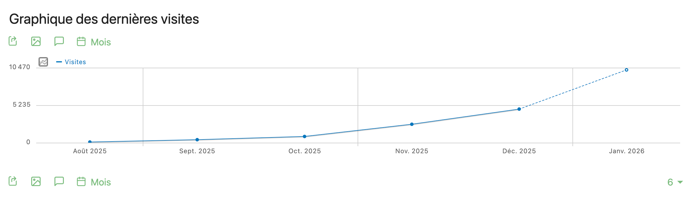

# 📊 Statistiques et impact
{: .no_toc }

- TOC
{:toc}

*Dernière mise à jour de la page : Janvier 2026*

## Introduction

**La construction de “Futur Pro” est guidée par les besoins des utilisateurs** : psychologues de l’éducation nationale, professeurs principaux de collège et évidemment les jeunes et leurs familles.

Pour nous assurer d’apporter un service pertinent à ces utilisateurs, en utilisant de manière efficace les ressources humaines et financières mises à disposition de l’équipe, **notre démarche est guidée par l’impact**.

Cette page présente un ensemble d’indicateurs nous permettant de mesurer régulièrement notre impact pour orienter notre stratégie et nos travaux.

## Impact global

{: .highlight }
> 🎯 **Notre mission** :
> 
> Permettre la construction de **stratégies de vœux** ancrées dans une **réalité terrain** et offrant des **perspectives favorables**.
>  
> Nos cibles :
> 
> - Dans un premier temps, les **psychologues de l’éducation nationale** (environ 4 400 PsyEN EDO titulaires ou stagiaires, [source](https://www.education.gouv.fr/les-psychologues-de-l-education-nationale-de-la-specialite-education-developpement-et-conseil-en-414042)) et les **professeurs principaux au collège** (environ un professeur sur deux, soit plus de 13 000, [source](https://www.education.gouv.fr/les-professeurs-principaux-la-rentree-2020-325729))
> - Dans un second temps, et en fonction des résultats de la première phase de tests, les **collégiens** (environ 2.7M, [source](https://www.education.gouv.fr/5657-millions-d-eleves-sont-scolarises-dans-le-second-degre-la-rentree-2023-380229)) **et leurs familles**

{: .secondary }
> 📊 **Ce que nous souhaitons mesurer à terme  :** 
> 
> **Diminution du nombre de voeux faits** sur le service d’affectation Affelnet **vers des filières sans perspectives**.

{: .note }
> 🧪 **Nos premières observations** : 
>
> - Lors de la phase de test :
>   - Plus de **70 accompagnateurs** et **70 élèves** ont participé à des **sessions de test de l’outil**
>   - **100% veulent avoir accès à l’outil développé et le considèrent utile pour mieux orienter**.
>   - **Le prototype a été partagé spontanément** à d’autres établissements, centre d’orientation et d’information, par des principaux,  des accompagnateurs et inspecteurs de l’éducation nationale.
> - Depuis le début de la phase de déploiement national :
>   - **Le trafic est en croissance exponentielle** (voir "Statistiques générales", ci-dessous)
>   - **Le trafic est de qualité**, avec 2/3 des visiteurs qui effectuent une recherche géographique et un temps moyen de visite supérieur à 5 minutes (voir "Statistiques générales", ci-dessous)
>   - **Un intérêt fort** exprimé pour cet outil **par les DRAIO, chefs d'établissements et accompagnateurs** rencontrés, ainsi qu'accueil unanimement positif et leur soutien dans les actions de mise en avant (partage spontané, mises en relation, etc.). Une extension du périmètre de l'outil, vers les jeunes et leurs familles, est même demandée.
> - Les principaux points forts évoqués :
>   - **Gain de temps**
>   - Mise en avant des **temps de trajets**
>   - Accès à des **données nouvelles ou difficiles à obtenir**
>   - **Simplicité d’utilisation**
>
> *”Le travail que vous avez réalisé est juste impressionnant et efficient. Bravo.
Je peux vous affirmer que nous allons l'utiliser, étant donné le temps que cela va nous faire gagner. Votre idée et votre projet sont formidables !” **Principal.e de Collège***
>
> *”L’outil va tellement me faire gagner du temps sur la recherche des temps de trajet avec les jeunes **PsyEn***

## Sous-objectifs

### Découverte des formations

{: .highlight }
1️⃣ Permettre la **découverte des formations professionnelles** accessibles

{: .secondary }
> 📊 **Ce que nous souhaitons mesurer à terme  :** 
> 
> Les utilisateurs se rendent sur des pages de **formations, notamment celles ne faisant pas partie des formations les plus connues** (sur Affelnet, en voie scolaire, 17% des formations regroupent 80% des voeux)

{: .note }
> 🧪 **Nos premières observations** : 
>
> - Certains testeurs ont découvert des formations ou des formations en établissement lors des sessions de test. Par exemple le “CAP agricole palefrenier soigneur”.
> - De nombreuses formations “moins demandées” sont recherchées pendant les tests, comme le “CAP monteur en installations thermiques” ou la “2de professionnelle métiers de la réalisation d'ensembles mécaniques et industriels”
> - Les informations concernant les temps de trajets en transports en commun, même pour des établissements relativement proches, surprennent certains accompagnateurs et leurs font revoir leurs conseils et recommandations.
> - **65%** des visiteurs effectuent une recherche géographique
> - Plus de **11k** pages de formations uniques ont été visitées entre Septembre et mi-Janvier
> - Les irritants à traiter dans de prochaines versions :
>     - la **naviagation via la carte** doit être améliorée pour faciliter la découverte
>     - les données de **transports scolaires** en zones rurales doivent être complétées
>
> *”Ce bac pro existe en France ? Je le découvre…”* ***PsyEn***
>
> *“J’ai vu des formations plus proches que je ne croyais et qui n’était pas dans mes recommandations habituelles“* ***Professeur.e Principal.e de 3e***

### Élargissement du champ des possibles

{: .highlight }
2️⃣ Mettre en avant les formations offrant des **devenirs plus favorables**

{: .secondary }
> 📊 **Ce que nous souhaitons mesurer à terme  :** 
> 
> Les utilisateurs se rendent davantage sur des pages de **formations ayant des devenirs favorables** : insertion dans l’emploi, poursuite d’études, ****formations d’avenir

{: .note }
> 🧪 **Nos premières observations** : 
>
> - Les labels liés à l’emploi où la poursuite d’étude suscitent des réactions et des questions.
> - Le lien entre le label et le module sur la poursuite d’études est à clarifier.
> - Des demandes ont été faites pour pouvoir recherche à partir d’un métier (d’avenir) ou d’une formation complémentaire.

### Construction d’une stratégie

{: .highlight }
3️⃣ Faciliter la construction d’une **stratégie de voeux adaptée**

{: .secondary }
> 📊 **Ce que nous souhaitons mesurer à terme  :** 
> 
> Augmentation du pourcentage de **premier voeux acceptés**

{: .note }
> 🧪 **Nos premières observations** : 
>
> - L’intérêt pour les données liées au taux de pression est très fort. Les données sont jusqu’alors jugées difficiles à obtenir mais cruciales.
> - La centralisation des informations permet un gain de temps et permet de mettre en place une stratégie plus éclairée.
> - Plusieurs demandes pour pouvoir intégrer des critères plus fins liés au profil du collégien, par exemple liées à son dossier scolaire, pour identifier des formations encore plus pertinentes.
>
> *”[…] il regroupe tous les éléments que l'on peut utiliser pour trouver un métier, une future voie professionnelle, mêlant localisation, formations proposées, taux de pression, poursuite d'études, évolution de carrière.“ Principal.e de collège*

## Statistiques générales

{: .secondary }
> 📊 **Quelques métriques supplémentaires (Sept. 2025 - mi-Jan. 2026) :**
>
> - plus de **16k visiteurs uniques** et une augmentation exponentielle du trafic
> - près de **100k** pages vues
> - temps de visite moyen de plus de **5 minutes 20 secondes**
> - **2/3** des visiteurs effectuent une recherche géographique et environ **40%** visitent des pages de détail

*Trafic par mois observé sur Futur Pro (sur l'outil de suivi Matomo) - Le mois de Janvier est incomplet (observation le 14/01) et présente tout de même un record d'affluence.*
